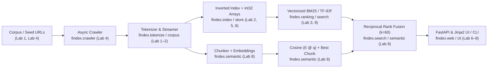

findex v1.0.0 — README.md (текст для копіювання)
Інструкція: виділіть весь моноширинний блок нижче, скопіюйте (Ctrl+C) та вставте безпосередньо у файл README.md.

# findex — Fast Keyword, Semantic & Hybrid Search Engine (`v1.0.0`)

`findex` is a type-checked (`pyright --strict`) full-text and semantic search engine built from scratch in Python, featuring an async crawler, `int32` NumPy-vectorized BM25/TF-IDF scoring, embedding-based retrieval with Reciprocal Rank Fusion (RRF), a CLI, and a FastAPI web service.

- **Live Deployment (Render):** https://findex-a9ma.onrender.com ([Web UI](https://findex-a9ma.onrender.com/) · [Swagger / OpenAPI](https://findex-a9ma.onrender.com/docs) · [Health](https://findex-a9ma.onrender.com/health) · [Stats](https://findex-a9ma.onrender.com/stats))
- **Demo Video (2–3 min walkthrough):** _Add screen-recording link before final submission_


### Headline Numbers

- **Corpus & Chunks:** 1,015 indexed documents (55,764 terms) in `index.bin`; 200-doc benchmark corpus split into 2,903 normalized 384-dim chunks (`all-MiniLM-L6-v2`).
- **Search Latency:** **0.13 ms** median for single-term NumPy BM25 (`6.44x` speedup vs. scalar Lab 3 loop on 1,011 matched docs); **1.42 ms** end-to-end hybrid/semantic retrieval locally.
- **Peak Speedups:** **6.44x** common-term scoring speedup via contiguous `int32` NumPy arrays and `np.argpartition` top-k.

---

## Architecture & Dataflow



---

## Consolidated Measurements (Labs 1–8)

### Profiling & Top-3 Hotspots (Before Optimization — Lab 8 M1)

Flame graphs are saved in `docs/profile_index.svg` and `docs/profile_search.svg`.

| Rank  | Function / Stage                                    | Baseline Time                      | Breakdown (Python vs. Native) | Optimization Applied                                                                             |
| :---- | :-------------------------------------------------- | :--------------------------------- | :---------------------------- | :----------------------------------------------------------------------------------------------- |
| **1** | `index.py:intersect_merge`                          | `0.178 s` (300 3-term queries)     | ~90% Python / ~10% Native     | Contiguous `int32` posting arrays (`postings_doc_ids`, `postings_tfs`) and NumPy set operations. |
| **2** | `ranking.py:BM25.score`                             | `0.131 s` (72,000 calls)           | ~88% Python / ~12% Native     | Vectorized `score_array` (`doc_lengths_arr[doc_ids]`) + `np.argpartition` / `lexsort` top-k.     |
| **3** | `index.py:_build_partial_from_docs` & `tokenize.py` | `0.638 s` (200 docs, 15,147 terms) | ~65% Python / ~35% Native     | Batch `int32` array construction on index merge and binary deserialization.                      |

### Scalar (Lab 3) vs. NumPy Scorer Speedup — 1,015 Docs (Lab 8 M2)

| Query        | Term / Text             | Docs matched | Lab 3 scorer (ms) | NumPy scorer (ms) |   Speedup |
| :----------- | :---------------------- | -----------: | ----------------: | ----------------: | --------: |
| common term  | `the`                   |        1,011 |            0.8400 |            0.1304 | **6.44x** |
| rare term    | `deconstruct`           |            1 |            0.0110 |            0.0362 | **0.30x** |
| 3-term query | `python async function` |           80 |            0.4091 |            0.2308 | **1.77x** |

- **Why `6.44x` on `the` and `0.30x` on `deconstruct`:** Large posting lists amortize NumPy array creation and C-loop dispatch across 1,011 items, whereas a 1-element posting list pays fixed NumPy setup overhead (`np.zeros`, `astype`) that exceeds a single scalar Python formula.

### Retrieval Evaluation: Precision@5 Across 15 Queries (Lab 8 M3)

Evaluated on 10 exact keyword queries (`Q01–Q10`) and 5 paraphrase queries without shared surface words (`Q11–Q15`) using `all-MiniLM-L6-v2` and RRF (`k = 60`).

| Query Group           | Queries                | Keyword (BM25) P@5 | Semantic P@5 | Hybrid (RRF) P@5 |
| :-------------------- | :--------------------- | -----------------: | -----------: | ---------------: |
| Exact keyword queries | `Q01–Q10` (10 queries) |           **1.00** |     **0.36** |         **0.76** |
| Paraphrase queries    | `Q11–Q15` (5 queries)  |           **0.08** |     **0.16** |         **0.12** |
| **Overall**           | **All 15 queries**     |           **0.69** |     **0.29** |         **0.55** |

- **Interpretation:** Exact keyword matching (`BM25`) excels on short exact module names (`1.00`), while semantic search surfaces conceptual matches on paraphrases (`0.16` vs. `0.08`). Hybrid RRF (`k = 60`) combines both signals without score-scale tuning.

### HTTP API & Web Load Benchmarks (Lab 7)

| Environment                        | Workload                                           |                        Throughput | p50 Latency | p95 Latency | p99 Latency |
| :--------------------------------- | :------------------------------------------------- | --------------------------------: | ----------: | ----------: | ----------: |
| **Localhost (Windows, 1 worker)**  | 200 reqs, concurrency 20 (`/search?q=python&k=10`) |                   **206.2 req/s** |  `64.87 ms` | `226.05 ms` | `324.24 ms` |
| **Cloud Production (Render Free)** | 100 reqs, concurrency 10 (remote RTT from Kyiv)    | **35.5 req/s** (`0.63 ms` search) | `234.01 ms` | `338.02 ms` | `714.48 ms` |

---

## CLI, API & Web Usage

```powershell
# 1. Build binary index
uv run findex index data/lab06_bench/crawl_c20.jsonl --out data/index.bin --positions

# 2. Generate chunked L2-normalized embeddings (.emb.npy + .emb_docs.npy)
uv run findex embed data/index.bin --corpus data/lab06_bench/crawl_c20.jsonl --model all-MiniLM-L6-v2

# 3. Search in keyword, semantic, or hybrid mode
uv run findex search data/index.bin "running tasks concurrently without blocking" --mode hybrid --k 5

# 4. Run web server (UI at /, API at /search?q=...&mode=keyword|semantic|hybrid)
uv run findex serve --index data/index.bin --port 8000
```

---

## Limitations & Next Steps

- **Scale beyond ~10⁶ chunks:** Brute-force matrix-vector search (`E @ q`) is linear in chunk count; past hundreds of thousands of chunks, swap in an **HNSW** index (`faiss` or `hnswlib`) and tune `efSearch` against recall@10.
- **Full re-embedding vs. incremental updates:** `findex embed` currently rebuilds chunk vectors for the index rather than diffing unchanged chunks or running background jobs from the FastAPI service.
- **Memory footprint on free hosting:** Loading large neural embedding models (`torch` / `sentence-transformers`) increases RAM usage; keep lightweight deployments focused on fast `int32` NumPy inverted-index serving unless embedding files are precomputed and memory budget allows.
- **Future RAG layer:** Layering an LLM synthesizer with source citations on top of `hybrid_search` (`findex ask`) is a natural next step.

---

## Development & Verification

```powershell
uv run ruff check .
uv run ruff format --check .
uv run pyright
uv run pytest -m "not slow" --benchmark-disable
```
