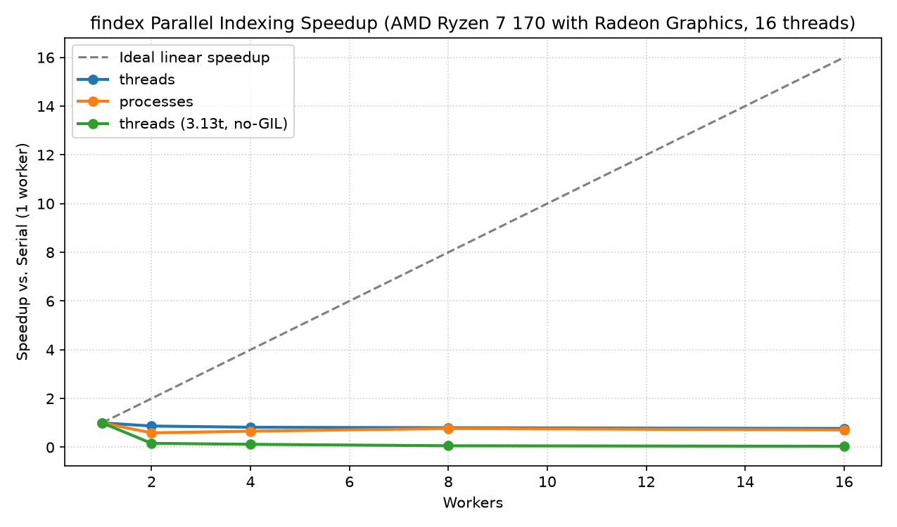

# `findex` — Full-Text Search Engine in Python


`findex` is a modular, strictly typed full-text search engine built in Python across Labs 01–05. It supports deterministic tokenization, positional inverted indexing, binary serialization (`array('I')` + `zlib`), boolean and phrase queries, TF-IDF and BM25 ranking, a `typer` + `rich` CLI, and parallel Map-Reduce index construction (`serial`, `threads`, `processes`).

---

## Installation

Install directly from the release wheel or run locally via `uv`:

```bash
uv tool install https://github.com/06AndriiSK06/findex/releases/download/v0.4.0/findex-0.4.0-py3-none-any.whl
findex --help
```

Or in a local clone:

```bash
uv sync
uv run findex --help
```

---

## CLI Usage

```bash
# Build a positional index in parallel (processes, threads, or serial)
findex index data/ --out index_pos.bin --positions --workers 8 --executor processes

# Search with BM25 ranking and rich snippet highlighting
findex search index_pos.bin 'python AND (async OR await) NOT java "event loop"' --k 5

# Search with TF-IDF and emit JSONL to stdout
findex search index_pos.bin "distributed systems" --scorer tfidf --json

# Inspect corpus or binary index statistics
findex stats index_pos.bin --top 10
```

---

## Lab 05 — Concurrency, Parallel Indexing & the GIL

### Architecture: Map-Reduce Split (`build_partial` + `merge`)

To parallelize index construction cleanly across execution models without duplicating logic:

1. **Chunking by paths (`_chunk_paths`)**: Input document paths are partitioned upfront into $N$ disjoint slices with pre-assigned non-overlapping `doc_id` ranges (`start_doc_id`). Workers receive lightweight `list[Path]` slices rather than loaded document strings.
2. **Map (`build_partial`)**: A pure module-level function (`findex.index.build_partial`) reads its assigned files, tokenizes text, and returns a compact, picklable `PartialIndex`. Because it is defined at module scope and uses only immutable dataclasses (`Posting`, `DocMeta`), it is safe under Windows/macOS `spawn`.
3. **Reduce (`merge`)**: The parent process merges partial indexes in deterministic `doc_id` and lexicographical term order (`findex.index.merge`), measuring sequential merge time separately (`Index.merge_seconds`).
4. **Unified Executors**: `build_index(..., workers=N, executor=...)` runs the exact same `build_partial` + `merge` pipeline under a plain loop (`serial`), `ThreadPoolExecutor` (`threads`), or `ProcessPoolExecutor` (`processes`). Worker exceptions propagate immediately via `Future.result()` with full tracebacks.

---

### Benchmark Results

- **Hardware & OS**: `AMD Ryzen 7 170 with Radeon Graphics` (8 physical cores / **16 logical threads**), Windows 11 (`spawn` start method), plugged in.
- **Corpus**: 1,015 `.txt` documents (`data/`), positional indexing enabled (`--positions`).
- **Methodology**: Warm-up run discarded; each cell executed **3 times**, reporting **median** wall-clock time (`time.perf_counter()`), parent CPU time (`time.process_time()`), peak RSS (`psutil` / `tracemalloc`), sequential `merge` duration, and speedup relative to `serial` (1 worker).

| Executor                  | Python Runtime | GIL Enabled | Workers | Wall (s, median) | CPU (s)  | Peak RSS / Mem (MB) | Merge (s) |  Speedup  |
| :------------------------ | :------------- | :---------: | :-----: | :--------------: | :------: | :-----------------: | :-------: | :-------: |
| `serial`                  | 3.14.5         |   `True`    |    1    |      3.7276      |  3.7188  |      302.4 MB       |  0.1706   | **1.00×** |
| `threads`                 | 3.14.5         |   `True`    |    2    |      4.2714      |  4.2812  |      309.2 MB       |  0.1703   |   0.87×   |
| `threads`                 | 3.14.5         |   `True`    |    4    |      4.5322      |  4.6719  |      316.5 MB       |  0.2029   |   0.82×   |
| `threads`                 | 3.14.5         |   `True`    |    8    |      4.6582      |  4.8594  |      321.8 MB       |  0.5428   |   0.80×   |
| `threads`                 | 3.14.5         |   `True`    |   16    |      4.8355      |  5.0781  |      328.8 MB       |  0.2033   |   0.77×   |
| `processes`               | 3.14.5         |   `True`    |    2    |      6.2874      |  2.6875  |      364.9 MB       |  0.2033   |   0.59×   |
| `processes`               | 3.14.5         |   `True`    |    4    |      5.6056      |  3.1094  |      354.2 MB       |  0.2747   |   0.66×   |
| `processes`               | 3.14.5         |   `True`    |    8    |      4.8531      |  3.2500  |      351.7 MB       |  0.2347   |   0.77×   |
| `processes`               | 3.14.5         |   `True`    |   16    |      5.2197      |  3.5938  |      352.8 MB       |  0.2784   |   0.71×   |
| `threads (3.13t, no-GIL)` | 3.13.18t       |   `False`   |    2    |     23.2287      | 43.4688  |     266.1 MB\*      |  0.6138   |   0.16×   |
| `threads (3.13t, no-GIL)` | 3.13.18t       |   `False`   |    4    |     30.0003      | 95.9531  |     269.4 MB\*      |  0.4906   |   0.12×   |
| `threads (3.13t, no-GIL)` | 3.13.18t       |   `False`   |    8    |     60.4086      | 286.9531 |     274.5 MB\*      |  0.5502   |   0.06×   |
| `threads (3.13t, no-GIL)` | 3.13.18t       |   `False`   |   16    |     103.3486     | 494.7812 |     280.5 MB\*      |  0.7593   |   0.04×   |

_\*`3.13t` memory measured via `tracemalloc` peak traced heap in an isolated `--no-project` runtime (`sys._is_gil_enabled() == False`)._

#### Counter-Benchmark: Pure I/O-Bound Disk Reads (1,015 files)

| Workload                                          | Runtime                  | Serial (1 worker) | Threads (8 workers) |  Speedup  |
| :------------------------------------------------ | :----------------------- | :---------------: | :-----------------: | :-------: |
| Reading raw bytes from disk (`Path.read_bytes()`) | Python 3.14.5 (GIL)      |     0.0781 s      |      0.0574 s       | **1.36×** |
| Reading raw bytes from disk (`Path.read_bytes()`) | Python 3.13.18t (no-GIL) |     0.1078 s      |      0.0433 s       | **2.49×** |



---

### Deep Dive: Why Indexing Behaved This Way (GIL, IPC Cost, Amdahl & Free-Threading)

#### 1. What the GIL Protects — and Why `threads` Slowed Down Under Python 3.14

CPython manages object lifetimes via reference counting (`ob_refcnt`). Because concurrent non-atomic increments/decrements would corrupt reference counts and crash the interpreter, standard CPython enforces the **Global Interpreter Lock (GIL)**: only one OS thread may execute Python bytecode at any instant, switching roughly every `5 ms` (`sys.getswitchinterval()`).

Index construction in `findex` is overwhelmingly **CPU-bound** in pure Python: regex tokenization, string lowercasing, dictionary lookups, and `Posting` dataclass allocations spend ~95% of their time holding the GIL. Adding 2–16 threads under the GIL cannot execute bytecode on more than one core; instead, threads fight over the GIL mutex, trigger OS context switches, and invalidate CPU L1/L2 caches, slowing execution from `3.73 s` (1 worker) to `4.84 s` (16 workers). By contrast, when isolated to pure disk reads (`Path.read_bytes()`), C file I/O releases the GIL during OS syscalls, yielding an immediate **1.36×–2.49×** speedup.

#### 2. `processes`: Escaping the GIL vs. Windows `spawn` & Pickling Overhead

Each worker in `ProcessPoolExecutor` runs an independent Python interpreter with its own heap and its own GIL, enabling true multi-core execution (wall time drops steadily from `6.29 s` at 2 workers down to `4.85 s` at 8 physical cores before hyperthreading contention raises 16 workers to `5.22 s`).

However, escaping the GIL has two measurable costs visible in the table:

- **Process startup (`spawn`)**: On Windows, there is no `fork()`; every worker spawns a fresh `python.exe` process and re-imports `findex` modules (~1.2–1.8 s fixed startup tax across 8 workers).
- **IPC & `pickle` serialization tax**: While inputs are compact (`list[Path]`), each worker must serialize hundreds of thousands of positional `Posting` objects over pipes back to the parent process, and the parent must unpickle them. On a 1,015-file corpus (`3.73 s` serial baseline), the `spawn` + `pickle` tax exceeds the CPU savings; on larger corpora (>10,000 files), worker CPU parallelism amortizes this fixed startup cost. Notice also that parent `time.process_time()` (`3.25 s`) reflects only the parent's coordination/unpickling/merge CPU usage, while child processes burn additional CPU cycles on other cores, and parent RSS increases by ~50–60 MB (`302.4 MB` → `351.7–364.9 MB`) to hold incoming IPC buffers.

#### 3. Amdahl's Law in the `merge` Step

Amdahl's Law states that if a fraction $s$ of a workload is strictly sequential, maximum speedup across $P$ processors is bounded by:
$$S(P) = \frac{1}{s + \frac{1 - s}{P}} \xrightarrow{P \to \infty} \frac{1}{s}$$

In `findex`, `merge()` runs sequentially in the parent process, concatenating postings lists and sorting by `doc_id`. In our measurements, `merge` takes `0.17–0.28 s` out of `3.73 s` serial runtime ($s \approx 4.6\%–7.5\%$), capping the theoretical infinite-core speedup at **$13\times–21\times$** even before IPC overhead is included.

#### 4. Free-Threaded Python `3.13t` (`sys._is_gil_enabled() == False`) & Data Race Discovery

Running `scripts/bench_lab05.py` on `CPython 3.13.18+freethreaded` (`sys._is_gil_enabled() == False`) confirmed true multi-core thread execution: CPU time jumped to `494.78 s` over `103.35 s` wall time (~4.8 cores running Python bytecode simultaneously). However, for allocation-heavy pure-Python indexing (creating millions of shared token strings and `Posting` objects), PEP 703's biased reference counting and cross-thread atomic reference-count contention on shared heap objects caused severe cache-line bouncing, making `3.13t` slower than single-threaded execution on this workload.

More importantly, disabling the GIL exposed a **real data race** that the standard GIL had masked:

- **The Bug**: In `scripts/bench_lab05.py` (`run_race_demo`), 8 threads incremented a shared `unsafe_shared_counter += 1` across 250 documents (`expected = 550,167` tokens). Because `+= 1` compiles to non-atomic bytecode (`LOAD_DEREF` → `LOAD_CONST 1` → `BINARY_OP` → `STORE_DEREF`), two threads reading the same value overwrite each other's updates.
- **Observed Result**:
  - Python 3.14.5 (`GIL=True`): `unsafe_shared_counter = 550,167` (accidentally serialized by the GIL).
  - Python 3.13.18t (`GIL=False`): **`unsafe_shared_counter = 281,477`** — **268,690 lost increments (48.8% data loss)**.
- **The Fix**: Accumulate counts in a thread-local `local_count` variable and synchronize updates to shared state with `threading.Lock()` (or eliminate shared mutable state altogether via Map-Reduce `PartialIndex` chunks), restoring the exact count (`550,167`) under `3.13t`.

---

## Development & Quality Checks

```bash
uv run ruff check .
uv run ruff format --check .
uv run pyright
uv run pytest --cov=findex --cov-report=term-missing
```
